<p align="center">
  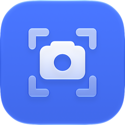
</p>

<h1 align="center">Snapr</h1>

<p align="center">
  Capturas de pantalla rápidas desde la barra de menús del Mac: captura, anota, lee texto, elige colores y fija imágenes sobre las demás ventanas.
</p>

<p align="center">
  <picture>
    <source media="(prefers-color-scheme: dark)" srcset="docs/images/editor-dark.png">
    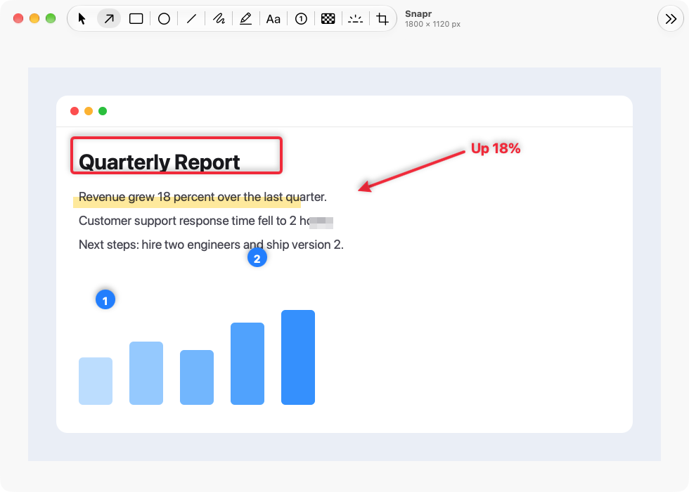
  </picture>
</p>

Snapr es una app nativa de macOS hecha en SwiftUI, inspirada en Shottr. Vive en la barra de menús, funciona sin conexión y no tiene cuentas ni servidor: los ajustes se guardan en el Mac y las imágenes en disco. Está en inglés y en español.

## Funciones

- **Captura** de un área, una ventana (con fondo transparente y sombra) o la pantalla completa, con atajos globales.
- **Lupa** con la cuadrícula de píxeles y el tamaño de la selección. Espacio cambia a modo ventana, Esc cancela.
- **Repetir la última área** y **captura con retardo** de 3 segundos.
- **Copiar la última captura** (⌥⌘C) desde el menú de la barra de menús, para volver a ponerla en el portapapeles.
- **Miniatura de vista previa** tras cada captura, con Copiar, Guardar, Editar, Fijar y Texto. Se puede arrastrar a Finder o a cualquier app.
- **Editor** con flecha, rectángulo, óvalo, línea, dibujo libre, resaltador, texto, contador de pasos, pixelado, foco y recorte. Deshacer y rehacer, zoom, copiar (⌘C) y guardar (⌘S).
- **Reconocimiento de texto (OCR)** y códigos QR con Vision: el texto va directo al portapapeles.
- **Selector de color**: copia el color hexadecimal del píxel bajo el cursor.
- **Fijar** una captura como ventana flotante siempre encima, con zoom, semitransparencia y menú contextual.
- **Captura con desplazamiento**: Snapr desplaza el contenido y une los fotogramas en una sola imagen alta.
- **Automatización** con enlaces `snapr://` desde Atajos, Raycast, Alfred, Stream Deck o la Terminal.
- **Abrir al iniciar sesión**, ocultar el icono de la barra de menús, color de acento y modo claro u oscuro.

## Interfaz

### Vista previa y ventana fijada

Después de capturar aparece una miniatura en la esquina de la pantalla. Una captura fijada flota sobre las demás ventanas.

<p>
  <picture>
    <source media="(prefers-color-scheme: dark)" srcset="docs/images/preview-dark.png">
    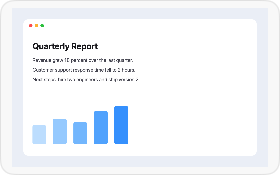
  </picture>
  &nbsp;
  <picture>
    <source media="(prefers-color-scheme: dark)" srcset="docs/images/pin-dark.png">
    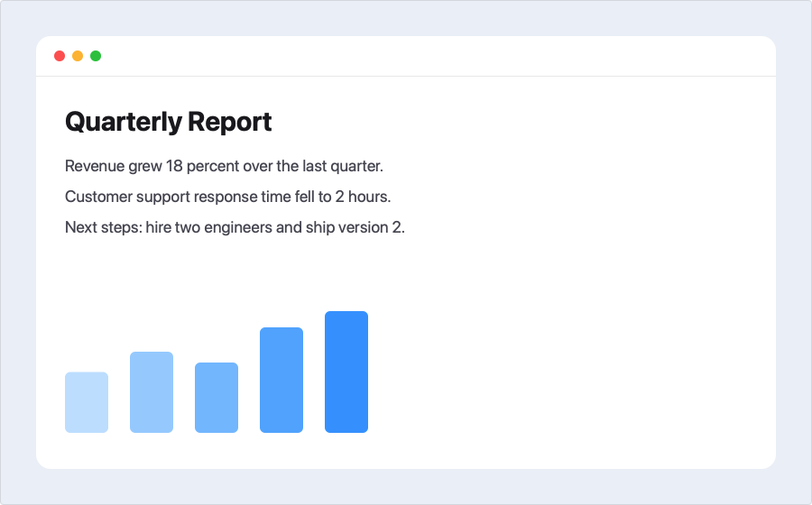
  </picture>
</p>

### Ajustes

Una pestaña por tema: General, Captura, Atajos, Avanzado y Apariencia.

<table>
  <tr>
    <td>
      <picture>
        <source media="(prefers-color-scheme: dark)" srcset="docs/images/settings-general-dark.png">
        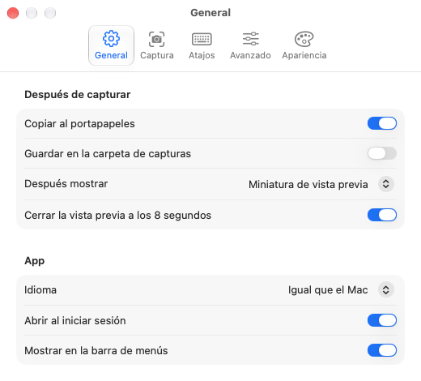
      </picture>
    </td>
    <td>
      <picture>
        <source media="(prefers-color-scheme: dark)" srcset="docs/images/settings-capture-dark.png">
        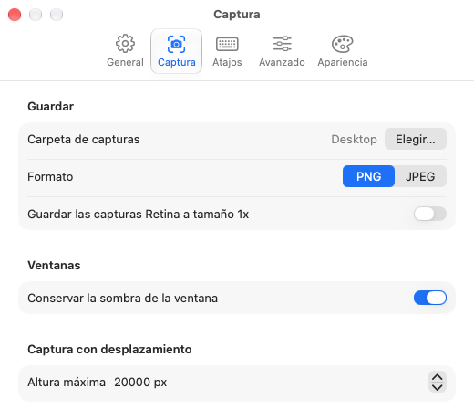
      </picture>
    </td>
  </tr>
  <tr>
    <td>
      <picture>
        <source media="(prefers-color-scheme: dark)" srcset="docs/images/settings-shortcuts-dark.png">
        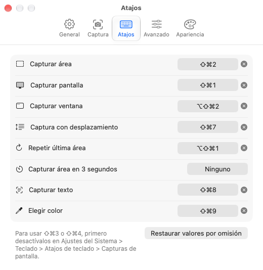
      </picture>
    </td>
    <td>
      <picture>
        <source media="(prefers-color-scheme: dark)" srcset="docs/images/settings-advanced-dark.png">
        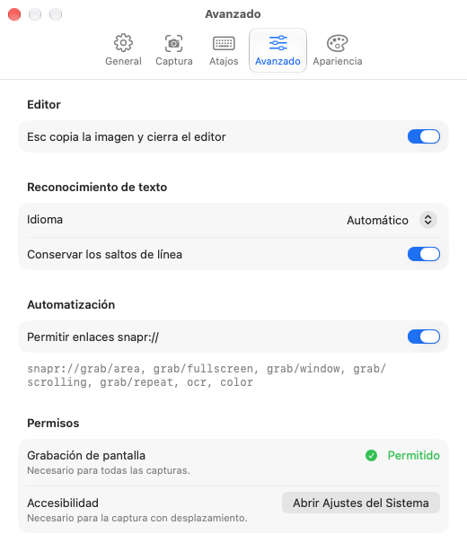
      </picture>
    </td>
  </tr>
  <tr>
    <td colspan="2" align="center">
      <picture>
        <source media="(prefers-color-scheme: dark)" srcset="docs/images/settings-appearance-dark.png">
        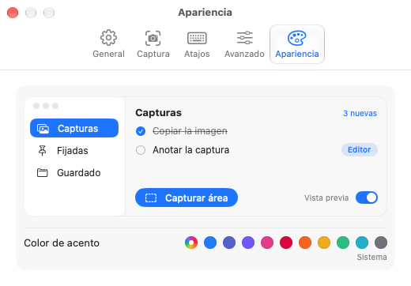
      </picture>
    </td>
  </tr>
</table>

### Ayuda y Acerca de

La ayuda (⌘?) explica cada captura, herramienta y ajuste en ocho temas.

<p>
  <picture>
    <source media="(prefers-color-scheme: dark)" srcset="docs/images/help-gettingStarted-dark.png">
    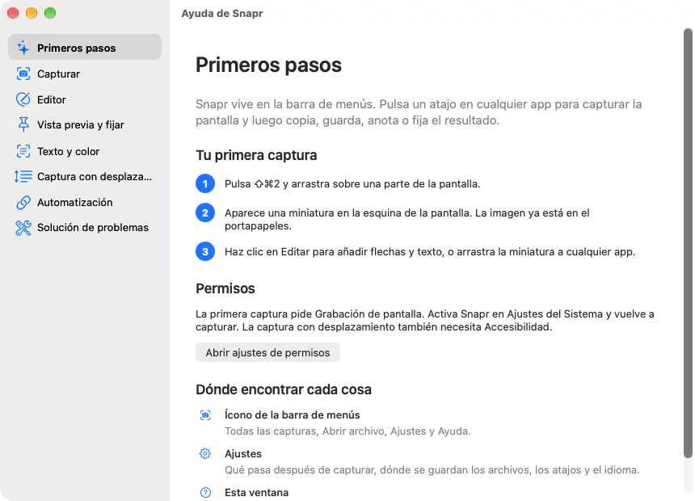
  </picture>
  <picture>
    <source media="(prefers-color-scheme: dark)" srcset="docs/images/help-editor-dark.png">
    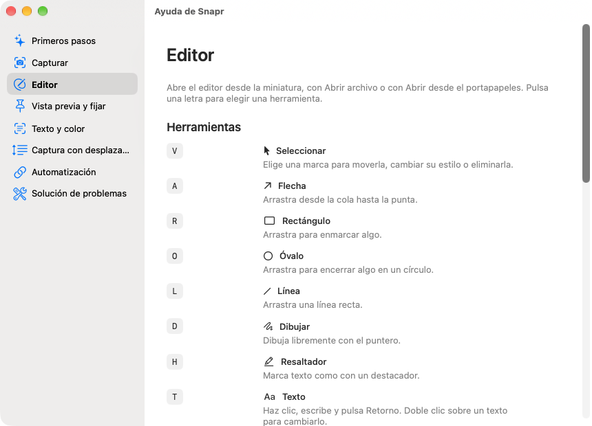
  </picture>
</p>

<p>
  <picture>
    <source media="(prefers-color-scheme: dark)" srcset="docs/images/about-dark.png">
    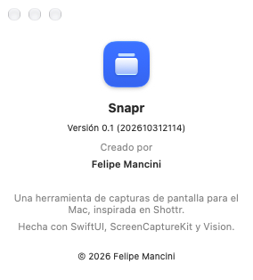
  </picture>
</p>

## Atajos

### Capturas (globales, se cambian en Ajustes > Atajos)

| Acción | Atajo |
| --- | --- |
| Capturar pantalla | ⇧⌘1 |
| Capturar área | ⇧⌘2 |
| Capturar ventana | ⌥⇧⌘2 |
| Repetir última área | ⌥⇧⌘1 |
| Captura con desplazamiento | ⇧⌘7 |
| Capturar texto | ⇧⌘8 |
| Elegir color | ⇧⌘9 |
| Capturar área en 3 segundos | sin atajo |

Los atajos por omisión evitan ⇧⌘3, ⇧⌘4 y ⇧⌘5, que macOS reserva. Para usarlos, desactívalos antes en Ajustes del Sistema > Teclado > Atajos de teclado > Capturas de pantalla.

### Herramientas del editor

| Tecla | Herramienta | Tecla | Herramienta |
| --- | --- | --- | --- |
| V | Seleccionar | H | Resaltador |
| A | Flecha | T | Texto |
| R | Rectángulo | C | Contador de pasos |
| O | Óvalo | B | Pixelar |
| L | Línea | S | Foco |
| D | Dibujar | X | Recortar |

## Automatización

Activa **Permitir enlaces snapr://** en Ajustes > Avanzado y abre cualquiera de estos enlaces:

```sh
open snapr://grab/area
```

| Enlace | Acción |
| --- | --- |
| `snapr://grab/area` | Capturar área |
| `snapr://grab/fullscreen` | Capturar pantalla |
| `snapr://grab/window` | Capturar ventana |
| `snapr://grab/scrolling` | Captura con desplazamiento |
| `snapr://grab/repeat` | Repetir última área |
| `snapr://grab/delayed` | Capturar área en 3 segundos |
| `snapr://ocr` | Capturar texto |
| `snapr://color` | Elegir color |

## Permisos

- **Grabación de pantalla**: necesaria para todas las capturas. La primera captura la pide.
- **Accesibilidad**: solo para la captura con desplazamiento.

Ajustes > Avanzado muestra el estado de los dos permisos. Cada Mac donde instales Snapr los pide por separado.

## Requisitos

- macOS 26 o posterior.
- Swift 6.2 o posterior (Xcode o las Command Line Tools) para compilar.

## Compilar e instalar

Snapr es un paquete Swift sin proyecto de Xcode.

```sh
./build.sh          # compila, firma e instala /Applications/Snapr.app
./build.sh --open   # además reinicia la app con la nueva versión
```

`build.sh` firma con tu certificado Apple Development si lo tiene el llavero y, si no, con firma ad hoc, suficiente para usar la app en tu Mac.

## Compartir con otras personas

```sh
tools/release.sh    # compila, firma con Developer ID, notariza y escribe dist/Snapr.zip
```

Necesita un certificado **Developer ID Application** y un perfil de `notarytool`; los pasos están en [`docs/RELEASE.md`](docs/RELEASE.md). Sin cuenta de pago, comparte el build ad hoc: en el otro Mac se abre la primera vez con clic derecho > Abrir.

## Pruebas

```sh
swift test --scratch-path ~/Library/Developer/Snapr/test-build   # pruebas unitarias
tools/selftest.sh                                                # funciones reales sobre un almacén en /tmp
tools/snap.sh                                                    # capturas de la interfaz en /tmp/Snapr-shots
```

`tools/snap.sh` genera las imágenes de este README en modo claro y oscuro. Para actualizarlas, cópialas de `/tmp/Snapr-shots/` a `docs/images/`.

## Estructura

| Ruta | Contenido |
| --- | --- |
| `Sources/Snapr/` | La app: barra de menús, capturas, editor, vista previa, ventanas fijadas, ajustes y ayuda. |
| `Sources/SnaprKit/` | Lógica sin SwiftUI: anotaciones, renderizado y unión de capturas con desplazamiento. |
| `Tests/SnaprKitTests/` | Pruebas unitarias de SnaprKit. |
| `Resources/` | Traducciones (`en.lproj`, `es.lproj`). |
| `Icon/AppIcon.icon` | Icono de la app (Icon Composer). |
| `docs/` | Brief, historias de usuario, índice de pantallas e imágenes. |
| `tools/` | Scripts de capturas, autoprueba, cuadrícula, icono y versión para compartir. |

## Créditos

Creado por Felipe Mancini. © 2026 Felipe Mancini.
